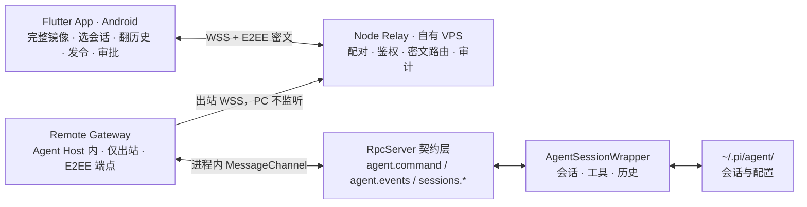

# Pi Agent Desktop 手机远程控制方案

> 状态：**v1.0 · 共识已确认**（经 16 轮设计拷问逐条拍板，可作为 M0 执行依据）
> 日期：2026-11-05
> 适用范围：Pi Agent Desktop v0.4.3（`ZhengHaoF/pi-desktop` fork）
> 技术前提：服务端 Node.js、手机端 Flutter（需求方指定）
> 决议记录：§12 为已确认共识，不再作为待决策项

---

## 0. 决策摘要

| 项 | 结论 |
| --- | --- |
| 可行性 | **可行**。PC 端核心 Agent 逻辑零改动，主要工作在新建三层与运维底座 |
| 总体架构 | PC 侧 `remote` Gateway（进程内 MessageChannel 复用 RpcServer）+ 独立 Node Relay + Flutter App |
| 服务端 | Node.js 22.19.x + TypeScript + Fastify + `ws` + TypeBox + SQLite + pino，Docker/Caddy，**自有 VPS 自托管** |
| 手机端 | Flutter（stable）从 M1 起，**仅 Android**；完整镜像 `agent.events`，独立选会话 + 可翻历史 |
| 网络 | **公网必需**，WSS/TLS；PC 只主动出站连 Relay，桌面端不开放入站端口 |
| 「随时可达」 | 仅保证：应用运行中 + 用户主动开启远程 + 系统未关机未断网；不承诺合盖/关机/断电 |
| 加密 | **M1a 就做最简 E2EE**（X25519，每设备独立密钥，Relay 零知识），不是后置档位 |
| 权限 | **完全继承桌面会话当前工具集** + PC 端一键总开关；安全控制点在设备与连接层，不做两套工具集 |
| 审批 | **无限挂起**直到手机上线或用户主动 abort；插件自带 `timeout` 的确认尊重原值 |
| 推送 | M1 不做后台推送，前台实时；iOS 后置到 M2 之后（iPhone 前期不可用） |
| 范围 | 只给自己，1 PC + 1~2 台 Android |
| 工程 | 本仓库子目录 + 独立 lock；M1a headless 起步不碰契约层，六文件同步推到 M1b |
| 阶段 | **M0 → M1a（链路验证）→ M1b（产品化）→ M2 → M3（可选）** |
| 最大代价 | 身份/审批桥从零建；Relay + Flutter 工程与 CI 从零建；单人承担全部运维承诺 |
| 最大风险 | 完全继承权限 + 公网 Relay + 无限挂起 = 一台长期 running、带完整 Bash/文件能力、等手机的 PC；鉴权写漏即 RCE |

**一句话**：不在现有 IM 渠道上改、不在 Renderer 上套壳；用进程内 MessageChannel 让 Gateway 成为 RpcServer 的第二个订阅者，手机通过自托管 Relay 全量镜像会话流并往同一会话发命令。

---

## 1. 背景、目标与非目标

### 1.1 现状

- 项目是 Electron 三进程桌面应用（Main / Agent Host `utilityProcess` / sandboxed Renderer），产物只有桌面安装包。
- 定位写着「本地优先 · 零内部服务器」，中英 README 承诺「不使用 TCP 端口承载 UI 或控制面」「不开放 webhook 或本地监听端口」。
- 已有微信 / Telegram / 飞书三个 IM 渠道，能实现「手机发消息 → PC 执行 Agent → 结果回传」，且 `QuickChannelBinding.tsx:132-150` 支持绑定到当前桌面会话共用上下文、`pi-session-bridge.ts:70-75` 复用活着的会话对象。**所以本方案的增量价值不是「让手机能发命令」**，而是：不依赖第三方 IM 账号、免手动绑定、支持 steer/abort/排队/审批、公网随时可达、自有端侧完整会话镜像。
- 上游 v0.4.3 与本地 fork 独有的 28 个提交里都没有远程连接实现，路线图也无该计划项。

### 1.2 目标

1. 手机**完整镜像** PC 会话流：逐字文本、工具调用、执行状态、回合结束（不是只收结果）。
2. 手机可**独立选会话、翻历史**（`sessions.list` / `contextPage` / `entryContent`），双端选中不同会话时各收各的。
3. 手机可追加指令、排队、steer、中止、切换模型、发起新会话。
4. 手机可处理 `confirm / select / input / editor` 四类扩展 UI 审批。
5. 公网可达；「随时可达」按 §0 的三条件定义。
6. 设备可撤销、操作可审计、会话正文对 Relay 不可见。

### 1.3 非目标（明确不做）

- **不做屏幕镜像 / 远程桌面**：不传截图、不注入键鼠、不复制桌面 UI。
- **不做后台推送**（M1），手机前台实时；锁屏弹通知不在本期。
- **不做 iOS**（M1–M2），只 Android；不准备 macOS 构建机、不申请 Apple Developer 账号。
- 不碰系统电源计划 / 注册表 / Wake-on-LAN；合盖、关机、断电、断网明确列为不支持。
- 不做多用户 SaaS 账号体系、多租户隔离、公开发布与商店上架。
- 不做「远程专用会话」或「远程只读工具集」——权限完全继承桌面会话。
- 不在中继持久化会话正文与模型凭据；不改动 Pi Coding Agent 运行时与 `~/.pi/agent/` 数据格式。
- 不引入 `@earendil-works/pi-server`（`scripts/check-pi-compatibility.mjs:30` 明确禁止）。

### 1.4 成功标准

**M1a 退出条件**：本机/内网起 Relay（自签证书），Flutter Android App 扫码配对后能看流、发令、中止、审批一次 `confirm`，E2EE 链路贯通，PC 侧 `npm run verify` 全绿。
**M1b 退出条件**：Relay 上自有 VPS 正式域名与证书，手机走 4G 能连上家里/办公室的 PC，完整镜像与翻历史可用，PC 总开关与设备撤销即时生效。

---

## 2. 现状基线：能复用什么、缺什么

### 2.1 可直接复用（代码事实，均已核实）

| 能力 | 位置 | 说明 |
| --- | --- | --- |
| 控制动作全集 | `src/contract/agent-commands.ts:25-50` | `agent.command` 是开放信封（`isAgentCommand` 只校验 `type` 非空），含 `prompt / steer / follow_up / abort / set_model / clear_queue / compact / extension_ui_response / get_state` 等 |
| 排队与 steer 语义 | `src/agent-host/rpc-manager.ts:553-567` | `prompt` 带 `streamingBehavior` 则直接注入，不带则 `enqueueTurn` 排队；远程只需透传字段，队列管理全现成 |
| 会话列表与运行状态 | `src/contract/api.ts:233-236, 588` | `sessions.list` 返回 `{sessions, runningSessionIds}`；`system.runningCount` 返回运行中 `sessionIds` |
| 会话切换 / 恢复 | `src/agent-host/handlers/agent.ts:84-95` | `agent.command` 对磁盘历史会话自动 `startRpcSession` 恢复并 `bindEvents`，无需新增 API |
| 流式事件 | `src/contract/api.ts:596`、`src/agent-host/session-event-bindings.ts:66` | `Streams["agent.events"]` 按 `sessionId` 为 key 推送 delta / 工具调用 / 回合结束；`SessionEventBatcher` 已做 20 Hz 限流 |
| 多订阅者 | `src/contract/rpc.ts:262-284, 454-510` | `AnyMessagePort` 明确兼容 `utilityProcess / worker_threads MessagePort`；`attachPort()` 可接受任意端口，`emit` 按 `topic+key` 匹配广播 |
| 双端选不同会话 | `src/renderer/lib/api-client.ts:269-270`、`rpc.ts:466` | 桌面按当前 `sessionId` 订阅；Gateway 按手机选的 `sessionId` 订阅即可，**无需任何裁决机制** |
| 会话自动接入事件流 | `src/agent-host/handlers.ts:61, 108-111` | `bindings.ensure()` 被渠道与 Agent handler 共用 |
| 历史与上下文 | `sessions.get / context / contextPage / entryContent / export`、`sessions.executions / executionContent` | `session-history.ts:289-369` 已实现 cursor 分页与 `historyRevision` 失效检测 |
| 文件读取 | `files.list / index / meta / read / preview / download` | `src/contract/api.ts:377-406` |
| 线协议 | `src/contract/rpc.ts:15-51` | `WireRequest / WireResponse / WireEvent / WireSubscribe / WireUnsubscribe` 五种 kind |
| 通用零件 | `channels/lane-scheduler.ts`、`media-store.ts`、`redaction.ts` | 串行调度、隔离暂存（20 MiB / 4 个 / 24h TTL / 拒绝符号链接）、脱敏 |
| 加密存储 | `src/main/credential-vault.ts` | `safeStorage` + `0o600` + 原子写 + fail-closed（需扩 key 白名单） |
| 审批幂等 | `src/agent-host/rpc-manager.ts:1102-1125` | 按 request `id` resolve，重复响应天然不会重复生效 |

**结论**：远程控制所需 13 类动作里 11 类已有 API，`rpc-manager.ts` **零改动**成立。

### 2.2 明确缺失

| 缺口 | 说明 |
| --- | --- |
| 设备身份 / 配对 | 现有 6 位配对码只用于桌面展示、审批靠 `pairingId`，**不参与校验**，无尝试次数限制；`credential-vault.ts:12` key 正则只认 `channel:(weixin\|telegram\|feishu):*` |
| 审批桥 | 扩展 UI 弹窗只存在于桌面 Renderer 的 React state；Browser 授权走 preload IPC、LAN 绑定确认走主进程原生 dialog，**都不在 RPC streams 内** |
| 审批超时语义 | `requestExtensionUi` 的 `timeout` 由插件 `opts.timeout` 决定并原样透传（`rpc-manager.ts:1077-1126, 1130-1185`）：**带 timeout 的确认 Host 会自行以 `defaultValue` settle，Gateway 拦不住**；未带 timeout 的才会永久挂起 |
| 保活 | 全仓无 `powerSaveBlocker` / `powerMonitor` / `setLoginItemSettings` |
| 中继与移动端工程 | `tsup.config.ts` 只有 3 组桌面入口；`scripts/` 65 个 mjs 全是桌面端/测试夹具；`build-desktop.yml` release 资产清单硬编码；零 Dart/Flutter 工具链 |
| 网络入站鉴权 | 没有任何面向网络控制面的认证、限流、防重放、审计强制门禁 |
| 门禁盲区 | `check-desktop-security.mjs:515-517` 的禁监听断言只覆盖三个 channel `api.ts`，新文件天然豁免；`check-architecture` 不禁止 `node:net`/`ws` |

### 2.3 架构澄清

**只要 PC 侧坚持「只主动出站连 Relay、不监听端口」，「零内部服务器」的前提基本保住**：Electron 内部仍无 TCP 服务，UI 与控制面仍走 MessagePort；Relay 是独立进程/独立主机，不属于桌面应用内部服务。README 措辞从「零内部服务器」调整为「桌面应用自身不开放入站控制面；可选连接用户自托管的 Node 中继」，中英两版同步。

---

## 3. 总体架构

### 3.1 三个角色

| 角色 | 运行位置 | 职责 | 是否新增 |
| --- | --- | --- | --- |
| **Remote Gateway** | Electron Agent Host 进程内（复用 Node 22 运行时，不新增进程） | 出站 WSS 连 Relay、E2EE 加解密、协议转换、鉴权、方法/topic 白名单、审批补推与挂起管理 | 新增模块 |
| **Relay（服务端）** | 独立 Node 进程，M1a 本机/内网 → **M1b 起自有 VPS** | 设备注册与配对、token 签发、host/device 路由、在线状态、元数据审计、限流；**零知识，不见会话明文** | **新建工程** |
| **Mobile App** | Flutter，M1 起仅 Android | 扫码配对、完整镜像会话流、独立选会话与翻历史、发指令/中止、处理审批 | **新建工程** |

> 需求方说的「服务端」对应 Relay；PC 侧 Gateway 不是独立服务、不监听端口。

### 3.1a 已核实的执行事实（M0 前必须消化）

**事实一（实现路径已定，不再是决策）：Gateway 走进程内 MessageChannel。**
`createRpcServer()` 的 `handlers` 是闭包内 Map（`rpc.ts:319`），只能通过 `onPortMessage` 经 port 调用，`registerHandlers()` 的注册结果未导出（`agent-host/index.ts:31`）。但 `AnyMessagePort` 的注释明确兼容 `utilityProcess / worker_threads MessagePort`（`rpc.ts:262-277`），`extractMessageData` 也处理了「payload 就是值本身」（`rpc.ts:286-293`）。因此确定方案：

> Gateway 在 Agent Host 内 `new MessageChannel()`（`node:worker_threads`），`port1` 交给 `server.attachPort()`，`port2` 自己收发 `WireRequest / WireResponse / WireEvent / WireSubscribe`。所有 handler 与事件订阅原样复用，**不碰 `handlers.ts`、不碰 Main、不新增 IPC 通道、不触发 `check-contract-coverage.mjs`**。

此前草案给过的「导出 handler 表」与「Main 转发 MessageChannelMain」两条路径均已作废。

**事实二：M1a 连 `api.ts` 都不用改。**
Gateway 用的是既有 `agent.command` / `sessions.*` / `files.*` 方法。真正需要新增 `remote.*` 契约方法的只有设置页开关、配对确认、托盘状态这类 UI 交互——这些归 M1b。因此 M1a 可做纯 headless（托盘菜单开关 + 配置文件），把六文件契约同步（`desktop.ts / preload.ts / ipc.ts / main.ts / api.ts / handlers.ts`）整体后置。

**事实三：双端选不同会话不是问题。**
桌面按 `sessionId` 订阅（`api-client.ts:269-270`），`emit` 按 key 精确匹配（`rpc.ts:466`）；Gateway 按手机选的 `sessionId` 建订阅即可，两端各收各的。

**事实四：审批的挂起能力有边界。**
`requestExtensionUi` 只在 `opts.timeout` 存在时 `setTimeout` 用 `defaultValue`（`false`/空）结束（`rpc-manager.ts:1116`），未带 timeout 的才会永久挂起（`1102-1125`）。所以「无限挂起」只对**未带 timeout 的确认**成立；带 timeout 的尊重插件原值，不改 `rpc-manager.ts`。挂起期间 `get_state` 显示 running、`setRunningSessionCount` 会让更新安装持续推迟。

### 3.2 分层图



### 3.3 关键数据流

1. **订阅**：Flutter `subscribe(agent.events, sessionId)` → Relay 校验 `(deviceId, hostId, sessionId)` → Gateway 经 `port2` 发 `WireSubscribe` → `server.emit` 的事件回 `port2`，Gateway 加密后转发手机。桌面与手机是同一条流的两个订阅者。
2. **指令**：Flutter `request(agent.command, {sessionId, type:"prompt", message})` → Relay 白名单与限流 → Gateway `port2.postMessage(WireRequest)` → 既有 handler → `AgentSessionWrapper.send()`。
3. **审批（无限挂起）**：Host 发 `extension_ui_request` → Gateway 转成 `remote.approval` 并**持久化挂起记录** → 手机在线则立即推送；不在线则等上线后补推 → 手机回 `extension_ui_response` → 按 id 原路 resolve（幂等）。用户 abort 回合或撤销设备时批量取消挂起，回 `defaultValue`（拒绝）。
4. **历史**：手机 `sessions.list` 选会话 → `sessions.get(historyWindow)` 首屏 → `contextPage(cursor)` 翻页 → `entryContent` 读大块。历史走请求/响应并同样加密，不进 WS 事件流。
5. **断线**：手机带 `lastSeq` 重连，Gateway 补发窗口内事件；缺口过大则手机重新 `sessions.get` 全量对齐。

### 3.4 进程与部署边界

| 阶段 | Relay 位置 | 传输 | 说明 |
| --- | --- | --- | --- |
| M1a | PC 同机或内网机器 | WSS + 自签证书 | 验证协议与三端链路，拓扑与公网一致但不上公网 |
| M1b | **自有 VPS** + 域名 | WSS + Caddy 自动 TLS | 手机走 4G 可连；PC 仍只出站，天然穿透 NAT/家庭防火墙 |
| 备选 | 内网 Relay + Tailscale / Cloudflare Tunnel | WSS | 省公网主机与证书运维，但引入第三方依赖；不作为默认 |

---

## 4. 协议设计：三端单一真源

### 4.1 与现有线协议对齐

复用 `rpc.ts:15-51` 的五种 `kind`，外层加信封；`payload` 在跨公网时承载**密文**：

```ts
interface RemoteEnvelope {
  v: number;            // 协议版本，hello 时协商
  traceId: string;      // 全链路追踪，进审计日志
  ts: number;           // 防重放时间窗
  nonce: string;        // 每次请求唯一
  deviceId?: string;    // 手机侧
  hostId?: string;      // PC 侧
  cipher?: {            // E2EE：Relay 只见密文与路由头
    alg: "x25519-aes-gcm";
    keyId: string;
    iv: string;
    tag: string;
  };
  payload: WireMessage | string; // 明文（仅本机诊断）或 base64 密文
}
```

**订阅匹配收紧**：`rpc.ts:140/466` 允许 `key === "*"` 通配；远程通道必须在 Gateway 层**禁止通配订阅**，只允许显式 `sessionId`，否则一台设备能订阅全部会话。这条要写成 `check-desktop-security.mjs` 的断言。

### 4.2 方法与 topic 白名单（M1 全量）

| 类别 | 允许 |
| --- | --- |
| 请求 | `sessions.list`、`sessions.get`、`sessions.context`、`sessions.contextPage`、`sessions.entryContent`、`sessions.executions`、`sessions.executionContent`、`agent.new`、`agent.command`（仅下列 type）、`files.list / meta / read / preview`、`system.runningCount` |
| `agent.command` type | `prompt / steer / follow_up / abort / get_state / clear_queue / set_model / set_thinking_level / extension_ui_response / extension_ui_input / compact` |
| 订阅 topic | `agent.events`、`agent.running`、`sessions.changed`、`files.changed`、`remote.approval` |
| 明确拒绝 | `mcp.oauth.*`、凭据读写、设置写入、更新器、Herdr 控制、受管进程启动、`set_tools`、任何 `key:"*"` 订阅 |

> `sessions.delete / rename`（`api.ts:257-258`）不进白名单：破坏性操作只在桌面端执行，远程误触代价不对称。
> `set_tools` 拒绝不是「降权」，而是因为权限完全继承桌面会话（§7.6），避免远程改动共享会话的工具集污染桌面端。

### 4.3 可靠性约定

- **幂等**：`request.id` 在 Relay 去重（滑动窗口 5 分钟），重发返回首次结果。
- **有序**：每条事件带单调递增 `seq`；手机乱序丢弃、缺口触发补发或全量重拉。
- **心跳**：WS ping/pong 15s，连续 3 次失败判定离线；PC 离线时手机显示最后状态，不排队写操作。
- **重连**：指数退避 + jitter，重连帧带 `lastSeq` 与 `protocolVersion`；**上线时优先补推挂起审批**。
- **背压**：每连接缓冲上限（建议 512 条 / 2 MiB），超限降级为摘要事件或断开让客户端重同步；手机渲染节流对齐桌面 `SessionEventBatcher` 的 20 Hz。
- **版本协商**：`hello` 交换 `protocolVersion / appVersion / hostVersion`，不兼容明确拒绝并提示升级哪一端。
- **挂起审批的可靠性**：挂起记录必须落 PC 侧本地存储（非 Relay），带 `requestId / sessionId / createdAt / expiresAt?`；App 重启后仍能补推；撤销设备或 PC 总开关关闭时批量 abort。

### 4.4 `packages/protocol` 单一真源

- **TypeBox** 定义 schema（项目已依赖 `typebox@1.3.27`），产出 TS 类型（Gateway / Relay）、JSON Schema（校验 + 生成 Dart 模型）、方法/topic 白名单常量。
- Flutter 侧用 `freezed + json_serializable` 或 `quicktype` 从 JSON Schema 生成模型，跑 golden JSON ↔ Dart 往返契约测试。
- **工程约束**：`server/`、`mobile/` 各用独立目录 + 独立 `package.json` / lock，**不动根 `package.json` 与 `package-lock.json`**——`check-dependency-contract.mjs` 对根依赖、`engines`、`esbuild` 版本、`npm ls` 结果有强断言，贸然引入 npm workspaces 会牵动整套门禁，且上游一改根 `package.json` 就冲突。

---

## 5. 服务端选型（Node.js）

### 5.1 选型原则

与桌面端同源（Node 22 + TypeScript + 严格类型）、依赖尽量少、协议自控（不绑定私有 WS 协议）、单机可跑、Relay 零知识、运维责任明确落在需求方自己身上。

### 5.2 技术栈决策表

| 项 | 选择 | 备选 | 理由 / 代价 |
| --- | --- | --- | --- |
| 运行时 | **Node.js 22.19.x LTS**，`.nvmrc` + `engines` 钉死 | Node 24 / Bun | 与桌面端 `package.json:10-12` 的 `>=22.19.0 <23` 一致，避免两套运行时与原生模块 ABI 问题 |
| 语言 | **TypeScript strict** | 纯 JS | 与桌面端一致，契约类型可共享 |
| HTTP 框架 | **Fastify** | Hono / Express | schema-first 校验、原生 TS 类型、pino 日志、插件生态成熟 |
| WebSocket | **`ws`**（原生 RFC 6455） | Socket.IO / uWebSockets.js | 协议自控，Flutter `web_socket_channel` 直连，能直接承载 `WireMessage`；Socket.IO 协议私有会锁死客户端 |
| Schema / 校验 | **TypeBox** | Zod / Ajv | 与项目已钉死的 `typebox@1.3.27` 同构，一套定义三端用 |
| 数据库 | **SQLite（`better-sqlite3`）** | Postgres + Drizzle | 设备/审计量级小，单实例足够；预留 `Repository` 接口。代价：原生模块需匹配 Node 22 ABI，Docker 固定基础镜像 |
| 在线状态 / 限流 | 进程内 Map + 令牌桶 | Redis | 单实例起步最简，`ConnectionRegistry` 抽象便于替换 |
| 认证 | **`node:crypto` Ed25519 挑战-响应** + 短时 access token + 轮换 refresh | 第三方 Identity | 不引入外部身份服务；代价是密钥轮换/撤销自己写对 |
| E2EE | **X25519 + AES-GCM**（每设备独立会话密钥） | libsodium secretbox | Node 与 Flutter 两端均有成熟实现；Relay 只转发密文，无法做内容级审计，只能按字节数与频率限流 |
| 日志 | **pino** + 脱敏钩子 | winston | 结构化、低开销；脱敏规则移植 `channels/redaction.ts` 并扩充设备/token 字段 |
| 配置 | 环境变量 + TypeBox 校验，启动即失败 | 裸 dotenv | 避免带错配置上线 |
| 部署 | **自有 VPS + Docker + Caddy 自动 HTTPS** | 托管 PaaS / 家里常开机器 | 需求方明确要求基础设施完全自控；代价见 §5.7 |
| 测试 | `node:test` + `ws` 集成 + 契约测试 | Vitest / Jest | 与项目 `*.test.mjs` 风格一致 |
| 推送 | **不做**（M1 无后台推送） | FCM / 厂商通道 | 前台实时即可；避免 Apple 账号、macOS 构建机与国内 FCM 不可达问题 |

### 5.3 推荐组合一句话

> Node 22 + TypeScript + Fastify + `ws` + TypeBox + SQLite + pino + X25519/AES-GCM，Docker 单容器 + Caddy，独立 `server/` 工程，部署在自有 VPS。

### 5.4 模块划分

```text
server/
├── package.json                 # 独立 lock，不动桌面端根依赖
├── Dockerfile / compose.yaml    # 固定 Node 22 基础镜像
├── Caddyfile                    # 自动 HTTPS + WS 反代
├── src/
│   ├── index.ts                 # 启动、配置校验、优雅退出
│   ├── http/                    # health / pair / devices / revoke
│   ├── ws/
│   │   ├── hub.ts               # ConnectionRegistry：host / device 连接池
│   │   ├── envelope.ts          # 信封解析、版本协商、签名校验（不解密）
│   │   ├── router.ts            # hostId/sessionId 路由、topic 过滤、通配拒绝
│   │   └── backpressure.ts      # seq、缓冲上限、补发窗口
│   ├── auth/
│   │   ├── pairing.ts           # 一次性配对令牌、尝试次数、TTL
│   │   ├── challenge.ts         # Ed25519 挑战-响应
│   │   └── tokens.ts            # access / refresh 签发、轮换、撤销
│   ├── policy/
│   │   ├── allowlist.ts         # 白名单常量（与 packages/protocol 共享）
│   │   ├── rate-limit.ts        # 设备级 / 连接级令牌桶
│   │   └── audit.ts             # append-only 元数据审计 + HMAC 摘要
│   ├── store/{repository,sqlite}.ts
│   └── telemetry/               # pino 日志、指标、健康检查
└── test/
```

### 5.5 数据模型（Relay 落地数据）

| 表 | 关键字段 | 备注 |
| --- | --- | --- |
| `devices` | `device_id`, `public_key`, `name`, `platform`, `created_at`, `last_seen`, `revoked_at` | 不存私钥 |
| `hosts` | `host_id`, `owner_device_id`, `label`, `version`, `online`, `last_seen` | 一台 PC 一个 hostId |
| `pairings` | `token_hash`, `host_id`, `challenge`, `expires_at`, `attempts`, `status` | **令牌参与校验**，失败次数锁定 |
| `refresh_tokens` | `token_hash`, `device_id`, `host_id`, `expires_at`, `rotated_from`, `revoked_at` | 只存哈希，轮换链与撤销 |
| `audit_events` | `id`, `ts`, `actor`, `action`, `target_digest`, `outcome`, `trace_id` | append-only，元数据 + HMAC，**不记正文** |
| `grants` | `device_id`, `host_id`, `session_id`, `scope`, `expires_at` | 会话级订阅授权 |

**不建 `messages` / `sessions` 内容表**：会话正文不落中继（§8.4）。挂起审批记录存在 **PC 侧**，不存 Relay。

### 5.6 端点

| 端点 | 用途 |
| --- | --- |
| `GET /healthz` | 存活 / 版本 / 连接数 |
| `POST /pair/request` | 手机提交配对令牌 + 公钥 + 挑战 |
| `POST /pair/approve` | PC 侧批准（也可走 WS，由 Gateway 转桌面确认） |
| `POST /auth/refresh` | refresh 轮换 |
| `POST /devices/revoke` | 撤销设备（须通知 Gateway 批量 abort 其挂起回合） |
| `WS /ws?role=host\|device` | 承载 `RemoteEnvelope`，host/device 两种角色 |

### 5.7 运维承诺（单人承担，必须写进 README）

- 自有 VPS 常开：域名（国内主机需备案）、Caddy 自动证书轮换、系统补丁、Docker 镜像升级。
- pino 结构化日志 + 脱敏；审计事件单独输出流。指标：在线 host/device 数、WS 消息速率、拒绝数、端到端延迟、补发次数、挂起审批数。
- 健康检查 + 优雅退出（断连通知两端重连，不静默丢消息）；SQLite 定期快照，密钥与数据库分离存放。
- **版本兼容**：桌面端 `allowDowngrade=false`，Relay 必须向后兼容至少两个桌面版本；协议靠 `v` 协商，不兼容时明确拒绝。
- 已知取舍：VPS 是单点，故障时两端都连不上；本方案不做多实例与自动故障转移。

---

## 6. 手机端选型（Flutter，仅 Android）

### 6.1 判断

**Flutter 从 M1 起、只做 Android**：E2EE 私钥进 Keystore、完整 `agent.events` 镜像是重 UI/重状态场景、原生 WS 长连接更可控。代价先认：仓库零 Dart/Flutter 工具链，需新建 SDK 钉版本、CI job、Android 签名与内测分发；发版有迭代成本；`flutter_markdown` 生态弱于 Web（§6.5）。

**iOS 明确后置到 M2 之后**：当前开发机是 Windows，Flutter iOS 构建必须 macOS + Xcode。前期 1~2 台手机里有 iPhone 就用不了，这是已接受的代价。

### 6.2 技术栈决策表

| 项 | 选择 | 备选 | 理由 / 代价 |
| --- | --- | --- | --- |
| SDK | Flutter stable + `fvm` 钉版本 | 追最新 channel | 三端版本可复现，CI 可控 |
| 项目结构 | feature-first + 轻 Clean 分层 | 严格 Clean | 规模可控，避免过度设计 |
| 状态管理 | **Riverpod（`hooks_riverpod`）** | Bloc / Provider | `StreamProvider` 天然适配事件流、编译期安全、易测 |
| 路由 | **go_router** | Navigator 2.0 手写 | 深链、扫码跳转、配对守卫统一 |
| WebSocket | **`web_socket_channel`** | `socket_io_client` | 与 `ws` 原生直连，自研重连/心跳/seq |
| HTTP | **dio** | http | 拦截器统一挂 token、超时、进度 |
| 数据模型 | **`freezed` + `json_serializable`** | 手写 | 不可变 + 联合类型适合按 `kind` 判别 `WireMessage` |
| 安全存储 | **`flutter_secure_storage`** + 可选 `local_auth` | shared_preferences | 设备私钥、refresh token 进 Keystore |
| E2EE | X25519 密钥交换 + AES-GCM | libsodium | 与 Relay 侧对称；私钥永不导出 |
| 扫码 / 深链 | `mobile_scanner` + `app_links` | — | 扫桌面二维码完成配对 |
| 本地缓存 | `drift` / `isar`（M1b） | M1a 仅内存 | 缓存会话列表与末页消息，重连按 `historyRevision` 对齐 |
| Markdown | `flutter_markdown` + `flutter_highlight` | WebView | 覆盖正文与代码块；复杂渲染降级见 §6.5 |
| 测试 | `flutter_test` + `integration_test` + golden | — | 消息气泡、工具卡、审批 sheet 做 golden |
| 分发 | 内测 APK / Firebase App Distribution | 正式商店 | 只给自己，不上架 |

### 6.3 页面与能力（完整镜像，不是薄壳）

```text
lib/
├── app/                  # 路由、主题、启动、深链
├── core/
│   ├── protocol/         # RemoteEnvelope、WireMessage、seq、重连、心跳、补推
│   ├── crypto/           # X25519 会话密钥、AES-GCM、密钥持久化
│   ├── auth/             # 挑战签名、token 轮换、安全存储
│   └── api/              # dio + ws 封装，方法/topic 白名单镜像
├── features/
│   ├── pairing/          # 扫码、设备指纹确认、配对状态
│   ├── session_list/     # 独立会话列表、运行状态、新建会话
│   ├── chat/             # 逐字流式、Markdown、工具卡片、输入框、排队/中止/steer
│   ├── approval/         # confirm/select/input/editor 四类审批，挂起与补推态
│   ├── history/          # 分页历史、执行记录、大内容块
│   ├── files/            # 工作区文件浏览与预览
│   └── settings/         # 已配对设备、断开、连接状态、权限展示（只读）
└── l10n/                 # 中英，与桌面端 i18n 术语对齐
```

### 6.4 关键实现要点

- **流式渲染**：按 `message_start / update / end` 增量拼接同一条消息，节流到约 20 Hz 再 `setState`；工具调用按 `tool_start / update / end` 折叠成卡片，语义复用 `channels/tool-progress.ts` 的投影思路。
- **审批（无限挂起）**：`extension_ui_request` 走 `remote.approval` topic，弹不可被消息流冲掉的持久 sheet；**App 上线后先拉取挂起清单再补推**；带 `expiresAt` 的（插件自带 timeout）显示倒计时，到点后明确显示「已过期/已在桌面端处理」，不静默默认；无 `expiresAt` 的一直等到用户响应或 abort。
- **附件**：图片走多模态预览与上传；非图片进 Gateway 隔离暂存区（`media-store.ts` 规则：20 MiB / 4 个 / 24h TTL / 拒绝符号链接），对模型标记为不可信输入。
- **离线**：断线保留最后快照与未发送草稿；重连 `hello` 带 `lastSeq`，缺口过大重新 `sessions.get` 全量对齐；不自动重放写操作。
- **密钥**：设备私钥永不导出、不进日志；换机重新配对（密钥丢失不恢复历史密文，历史按需重新拉取并走同一加密通道）；桌面端可一键撤销。

### 6.5 与桌面端渲染能力的已知差距（写进产品说明）

| 桌面端 | Flutter 端 |
| --- | --- |
| Mermaid 流程图 | 降级为代码块 + 「在桌面端查看」提示 |
| KaTeX 公式 | 降级为原始 LaTeX 文本 |
| 完整语法高亮语言集 | 常见语言子集 |
| 内置浏览器 / 文件多标签 / 图床灯箱 | 不提供 |
| 工具执行树、Codemode 图片 | 折叠卡片 + 静态预览 |

M3 可评估受限 WebView 渲染 Mermaid/KaTeX，非必做。

### 6.6 工程与分发

- 新增 `.github/workflows/mobile.yml`：`flutter analyze` → `flutter test` → Android build → 内测 APK 分发；**iOS job 不建**。
- `build-desktop.yml` 的 release job 资产清单是硬编码白名单（`:1125-1148`），新增移动端资产必须同步扩展，否则会被当作 stale asset 清除。
- 版本号与桌面端解耦，协议版本写进 `hello` 并做兼容矩阵测试；`THIRD_PARTY_NOTICES.md` 与 SBOM 补 Flutter/Dart 侧依赖。

---

## 7. PC 端改造（Remote Gateway）

### 7.1 为什么不做成第 4 个消息渠道 adapter

| 问题 | 证据 |
| --- | --- |
| `runExternalTurn` 单轮、不可打断，不支持 steer/abort/排队 | `pi-session-bridge.ts:119-195`、`rpc-manager.ts:412-464` |
| `externalTurnActive=true` 时把 `extension_ui_request` 静默返回 `false` | `rpc-manager.ts:1023-1030, 1084-1091` |
| `ChannelId`、路由键、配对、bot 凭据、出站文件全是 IM 领域模型 | `shared/channel-types.ts:1`、`channel-manager.ts:79-91, 690-738`、`adapter-registry.ts:4-8` |

结论：在 `src/agent-host/remote/` 另起独立 transport，经进程内 MessageChannel 复用 `RpcServer`；只复用 `LaneScheduler` / `media-store` / `redaction` 三个无 IM 语义的零件。

### 7.2 Gateway 模块

```text
src/agent-host/remote/
├── gateway.ts            # 生命周期、出站 WSS、重连、hello 协商、进程内 MessageChannel
├── protocol.ts           # RemoteEnvelope ↔ WireMessage、E2EE 加解密、seq、幂等
├── policy.ts             # 方法/topic/type 白名单、通配订阅拒绝、设备授权
├── approval-bridge.ts    # 挂起记录持久化、上线补推、按 id 回收、批量 abort
├── pairing.ts            # 配对令牌生成、桌面端批准回调
├── presence.ts           # 在线状态、心跳、托盘状态（M1b）
├── power.ts              # powerSaveBlocker / 开机自启（M1b）
└── audit.ts              # 元数据审计、脱敏
```

### 7.3 门禁联动：分两阶段

**M1a（headless，零契约改动）**：只新增 `src/agent-host/remote/` 与 `src/agent-host/index.ts` 里创建 MessageChannel 的几行；托盘开关走现有托盘菜单机制或配置文件。**不新增 `Api` 方法、不新增 IPC 通道**，`check-contract-coverage.mjs` 的六文件同步不触发。

**M1b（UI 化，需同步六处）**：

| 文件 | 改动 |
| --- | --- |
| `src/contract/api.ts` | 新增 `remote.status / pairingApprove / pairingReject / deviceRevoke / setEnabled / abortPendingApprovals` 与 `remote.status` / `remote.approval` streams |
| `src/agent-host/handlers.ts` | 注册对应 handler |
| `src/contract/desktop.ts`、`src/preload/preload.ts`、`src/main/ipc.ts`、`src/main/main.ts` | 设置页开关、配对确认、托盘状态、防休眠控制；`check-contract-coverage.mjs` 要求精确一一对应 |
| `src/main/credential-vault.ts:10-16` | key 白名单扩 `remote:<hostId\|deviceId>:...`，同步 `desktop.ts` 类型与 `main.ts:705-706` 拼装 |
| `scripts/check-desktop-security.mjs` | **主动把 `remote/*.ts` 加进 `read()` 列表**并写断言：禁通配订阅、禁本地监听、禁凭据回读 Renderer、脱敏、挂起审批必须可批量取消 |
| `scripts/architecture-policy.mjs` | 单模块 ≤1200 行；按上表拆分后应无需加 budget |
| `src/main/protocol.ts:20` | **不改 CSP**；Gateway 在 Node 侧出站，Renderer 不直连 WS，`connect-src 'self' app:` 保持 |
| `electron-builder.yml:113-116` | 仅当用 `piagent://` 深链唤起时新增 scheme |
| `README.md` / `README.en.md` | 第 9 / 283 / 289 / 295 行按 §2.3 改措辞，补隐私与运维章节 |
| `.github/workflows/build-desktop.yml` | 新增 `server` / `mobile` job；扩展 release 资产白名单 |
| `THIRD_PARTY_NOTICES.md`、SBOM | 补服务端与移动端依赖 |

### 7.4 审批桥：三类确认分别处理

| 确认类型 | 现有通道 | 策略 |
| --- | --- | --- |
| 扩展 UI（`confirm/select/input/editor`） | `agent.events` → 桌面 Renderer React state | **桥出来 + 无限挂起**：Gateway 识别 `extension_ui_request` → 持久化挂起 → `remote.approval` → 手机回 `extension_ui_response`（按 id 幂等）。插件带 `timeout` 的尊重原值，Host 自行以 `defaultValue` 结束；不带的可无限挂起。远程必须走 `agent.command` 而非 `runExternalTurn` |
| Browser 工具授权 | main ↔ renderer preload IPC，不在 RPC streams 内 | **fail-closed 拒绝**：远程不桥这条，桌面端处理 |
| 受管进程 LAN 绑定确认 | agent-host → main `parent-rpc` + 原生 dialog | **fail-closed 拒绝**：远程会话禁止触发 LAN 绑定 |

**挂起必须的兜底（硬约束）**：桌面端提供「一键中止全部挂起审批」；`POST /devices/revoke` 与 PC 总开关关闭时，Gateway 批量 abort 该设备/全部挂起回合并回 `defaultValue`；否则设备丢失会让会话永久停在 running 态、自动更新被无限推迟。

### 7.5 保活与自启（M1b，不在 M1a）

- 仅在用户开启远程时 `powerSaveBlocker.start('prevent-app-suspension')`，关闭立即 stop；设置页明示耗电影响。
- `app.setLoginItemSettings({ openAtLogin: true })` 由用户显式勾选。
- **不碰系统电源计划 / 注册表**：合盖、关机、断电、断网明确不支持，手机端显示离线原因与最后状态。
- 托盘显示「远程控制：已连接 · N 台设备」，提供**一键总开关**（§7.6）。
- `before-quit`（`main.ts:928-975`）确保 Gateway 先于 Host 停止，避免半开连接。

### 7.6 权限：完全继承 + PC 总开关

- 手机与桌面指向**同一个 sessionId**，工具集是会话级状态，权限天然一致；不做「远程只读工具集」，因为那要在共享会话上反复 `set_tools`，有竞态且会污染桌面端。
- `set_tools` 不向远程开放（白名单拒绝），避免远程改动共享状态。
- 安全控制点上移到**设备与连接层**：设备授权、用户显式开启远程、PC 端一键总开关（立即断开全部设备 + abort 挂起审批）、设备即时撤销、token 轮换、限流与审计。
- 后果明确写进 README：一台已配对设备在总开关开启时，等价于持有该会话的完整 Bash / 文件 / Browser 能力。

---

## 8. 身份、配对与安全

### 8.1 信任模型

Relay 是**路由与鉴权方，且零知识**（只见密文与路由头）；PC 是执行方与数据持有方；手机是受控发起方。不涉及多用户与租户隔离。

### 8.2 配对流程

```mermaid
sequenceDiagram
    participant U as 用户
    participant PC as 桌面端/托盘
    participant G as Remote Gateway
    participant R as Node Relay · VPS
    participant M as Flutter App · Android

    U->>PC: 点击「添加设备」
    PC->>R: 申请一次性配对令牌（高熵，TTL 5-10 min）
    R-->>PC: token + 二维码（relay 地址 / hostId / token）
    U->>M: 手机扫码
    M->>M: 生成 Ed25519 密钥对 + X25519 会话密钥材料
    M->>R: pair.request(token, publicKey, deviceName, platform)
    R->>R: 校验 token 哈希 + 尝试次数 + 限流
    R-->>PC: 待批准（设备名 / 平台 / 公钥指纹）
    U->>PC: 人工确认指纹
    PC->>R: pair.approve
    R-->>M: deviceId + refresh token + hostId
    M->>R: WSS hello（挑战-响应签名 + 协议/密钥版本协商）
    R->>G: 建立 host 路由
    G<->>M: X25519 协商会话密钥，后续全为密文
```

**与现有配对的关键差别**：令牌参与服务端校验、有尝试次数与锁定、设备持有非对称密钥、批准时展示公钥指纹。现有 `channel-manager.ts:805-839` 的 6 位码只用于桌面展示，不能搬。

### 8.3 密钥与 token

- 设备：Ed25519 密钥对（身份）+ X25519 会话密钥（内容加密），私钥存 Keystore，永不上传。
- 每台设备独立配对、独立密钥；不做多设备密钥分发。换机重新配对，历史密文不迁移（按需重新拉取）。
- 连接：`hello` 挑战-响应验签；`node:crypto.timingSafeEqual` 常量时间比较。
- access token 短时、refresh 单次轮换并保留轮换链检测重放；撤销立即生效并触发挂起审批批量 abort。
- PC 侧 host 凭据存 `credential-vault`（扩 key 白名单后）。

### 8.4 会话内容保护（唯一档位：M1a 起 E2EE）

> **不再是「先 TLS 后加密」两档。** 公网 Relay 会经手代码片段、工具结果、可能的敏感路径，TLS 只保护传输、Relay 进程内存仍是明文。因此 M1a 就做端到端加密：

- X25519 协商会话密钥 → AES-GCM 加密 `payload`；Relay 只解码信封的 `v / traceId / hostId / deviceId / keyId`，**不解密、不落盘正文、不写正文日志**。
- 审计只记元数据 + HMAC 摘要（参考 `browser-service.ts:1137-1155`）。
- 代价（已接受）：Relay 无法做内容级审计与限流，只能按字节数与频率限流；手机端历史缓存需本地解密；密钥丢失即无法解密旧缓存，历史需重新拉取。
- M1a 本机/内网联调时允许临时关闭 `cipher` 便于抓包诊断，但 `hello` 必须协商该开关且**公网配置下强制开启**，配置校验启动即失败。

### 8.5 强制控制项

- 每设备 / 每连接令牌桶限流；配对端点更严格的限流与失败锁定。
- `nonce` + 时间窗防重放；`request.id` 幂等去重。
- 拒绝通配订阅、白名单外方法、跨 `hostId` 路由；Gateway 与 Relay 双向校验。
- 审计：配对、批准、撤销、连接、审批决策、被拒请求、挂起与补推，全部 append-only 且脱敏。
- 远程默认拒绝清单：凭据读写、MCP OAuth、更新器、Herdr 控制、受管进程启动、Browser 授权、LAN 绑定、`set_tools`、破坏性会话操作。
- PC 总开关关闭 = 立即断开所有设备 + 清空在线态 + abort 全部挂起审批。

---

## 9. 风险登记

| # | 风险 | 等级 | 缓解 | 阶段 |
| --- | --- | --- | --- | --- |
| 1 | **完全继承权限 + 公网 Relay + 无限挂起**：长期 running、带完整 Bash/文件/Browser 能力的 PC 等一台可能永不上线的手机；token 泄露或设备丢失即完整 RCE | 高 | 设备授权 + 总开关 + 即时撤销 + 撤销/关开关时批量 abort 挂起回合；禁通配订阅；Gateway/Relay 双向白名单；安全断言写进 `check-desktop-security.mjs`；M1b 上线前攻击面评审 | M1a/M1b |
| 2 | 门禁不会自动拦住新网络模块（禁监听断言只覆盖三个 channel `api.ts`，新文件天然豁免） | 高 | 主动把 `remote/*.ts` 加入安全检查 `read()` 列表并写断言；PR 模板加安全自查 | M1a |
| 3 | **无限挂起**导致会话永久 running、`setRunningSessionCount` 让自动更新无限推迟；设备丢失后无人收尾 | 高 | 桌面端「一键中止全部挂起审批」；撤销设备/关总开关批量 abort；手机端明确显示挂起数与时长；README 写明这是设计选择 | M1a |
| 4 | 设备身份与 E2EE 从零建，现有配对码/凭据库白名单均不可直接用 | 高 | §8.2/§8.3；`credential-vault` 扩 key 白名单；不复用 6 位码 | M1a |
| 5 | 单人承担 VPS 全栈运维（域名/备案/证书/补丁/监控/备份/升级），且 Relay 是单点 | 中高 | Docker + Caddy 自动化、健康检查、SQLite 快照、指标与日志；README 写明单点与运维责任 | M1b |
| 6 | 审批链路三条割裂，插件自带 timeout 的确认 Host 会自行拒绝，Gateway 拦不住 | 中高 | 只桥扩展 UI 并尊重原 timeout；另两类 fail-closed 并在 UI 明示；远程不走 `runExternalTurn` | M1a |
| 7 | 「随时可达」实际打折：无后台推送 + 前台实时 + 无限挂起 → 离开且没开 App 时任务停住 | 中高 | 产品说明明确语义；手机端显示离线原因与挂起清单；不作为 bug 处理 | M1b |
| 8 | Relay 与桌面端版本错配（桌面端 `allowDowngrade=false`） | 中 | 协议版本协商 + 兼容矩阵测试 + Relay 向后兼容两个桌面版本 | M1b |
| 9 | 服务端 + 移动端工程与 CI 从零，桌面端 release 资产清单硬编码 | 中 | 独立 `server/` / `mobile/` 工程与 lock、新增 workflow job、扩展资产白名单 | M1a |
| 10 | Flutter 渲染弱于 Web，Mermaid / KaTeX 缺失；iOS 前期不可用 | 中低 | 明确降级策略与平台范围并写进产品说明 | M1a |
| 11 | 供应链面扩大（Dart/Flutter/Node 新依赖、SBOM、许可证） | 中低 | 锁版本、SBOM、`THIRD_PARTY_NOTICES.md`、依赖审计进 CI | M1b |
| 12 | 产品定位从「零内部服务器」变更的用户信任成本 | 中低 | 措辞按 §2.3 精确调整；远程默认关闭、显式开启、一键断开 | M1b |

---

## 10. 分阶段实施与验收

> 用阶段与交付物描述，不绑定时间估算；每阶段以验收标准作为退出条件。**M1 拆成 M1a / M1b 是已确认共识**，目的是给满档方案留一个可回退的中间点。

### M0 · 协议冻结

- 交付物：`packages/protocol` v1（TypeBox schema + JSON Schema + 白名单常量）；`docs/rpc-protocol` 风格协议说明；E2EE 信封与 `hello` 协商定稿；三端 golden JSON。
- 退出：三端对同一组 golden JSON 互相解析通过；白名单与安全断言清单评审通过。

### M1a · 链路验证（可回退点）

- **范围**：Relay 跑 PC 同机或内网机器（自签证书）；Gateway 进程内 MessageChannel，headless（托盘/配置开关，不改契约层）；Flutter Android App 最小可用；E2EE 贯通；只做配对、看流、发令、中止、一次 `confirm` 审批、挂起与补推。
- **不做**：VPS 上线、正式域名与证书、防休眠/开机自启、会话列表与翻历史、工具卡与文件预览、设置页与托盘 UI、后台推送、iOS。
- 验收：
  1. 扫码配对成功，桌面端显示设备指纹且可撤销；Relay 日志中无任何会话明文。
  2. 手机逐字看到桌面会话输出；追加指令后 PC 继续执行；点「停止」能中断回合。
  3. 触发一次 `confirm`，手机能审批且 PC 按决策继续；手机离线时挂起、上线后补推并可审批。
  4. 通配订阅、白名单外方法、跨 hostId 请求、重放请求均被拒绝并有审计记录。
  5. 撤销设备或关闭总开关时，挂起审批被批量 abort，会话不再停在 running 态。
  6. PC 侧 `npm run verify` 全绿（含新增安全断言）。
- **退出判断**：若 M1a 无法跑通，就此止损，不投入 VPS 与 UI 化。

### M1b · 产品化

- **范围**：Relay 上自有 VPS（域名/备案/Caddy 正式证书/Docker/监控/备份）；PC 契约层六文件同步、设置页与托盘、总开关、`powerSaveBlocker` 与开机自启；Flutter 完整镜像（会话列表 + 翻历史 + 工具卡 + 文件预览 + i18n）；挂起审批的桌面端管理界面。
- 验收：手机走 4G 能连上家里/办公室的 PC；双端选不同会话时各收各的事件；断网重连后事件不丢不重；撤销设备后连接立即断开且挂起被清理；PC 睡眠策略可配置且符合 §0 三条件；安全评审清单全过。

### M2 · 加固与扩展

- 范围：token 轮换链与撤销审计导出、限流与防重放加固、E2EE 密钥轮换工具、兼容矩阵 CI、Android 内测分发管线、Mermaid/KaTeX 降级优化。
- 验收：攻击面清单逐条通过；旧版桌面端仍能连新版 Relay；密钥轮换不丢会话。

### M3 · 可选进阶（不在当前承诺内）

- iOS 支持（需 macOS 构建机 + Apple Developer 账号）、后台推送（需评估国内通道）、多 PC / 账号体系、E2EE 密钥恢复、Relay 多实例与故障转移、受限 WebView 渲染 Mermaid/KaTeX。

---

## 11. 测试策略

| 层 | 内容 |
| --- | --- |
| 协议 | golden JSON 三端往返；schema 校验；版本协商拒绝用例；`cipher` 缺失/篡改/重放 |
| Relay | `node:test` 单测（配对、验签、轮换、限流、白名单）+ WS 集成（双端模拟、断线、乱序、背压、幂等、零知识断言：服务端日志与存储不含正文） |
| Gateway | 桌面端 `*.test.mjs` 风格；mock `RpcServer` 验证方法映射、topic 过滤、通配拒绝、审批往返、挂起持久化与批量 abort |
| 审批 | 带 `timeout` 与不带 `timeout` 两类确认分别测试；手机离线挂起 → 上线补推 → 按 id 响应；abort / 撤销 / 总开关关闭时的清理 |
| 桌面端 | 现有 `npm run verify` 全链；新增 `smoke` 验证 Gateway 生命周期与 `before-quit` 清理 |
| Flutter | `flutter_test` 单测 + golden（消息气泡、工具卡、审批 sheet、挂起态）+ `integration_test` 连本地 Relay |
| 端到端 | M1a 起维护「扫码 → 看流 → 追加 → 中止 → 审批（含离线挂起/补推）」自动化脚本，作为每阶段回归 |
| 安全 | 未配对连接、过期 token、重放、跨 host 订阅、通配订阅、越权方法、配对爆破、设备撤销后残留连接 |

---

## 12. 已确认共识（经 16 轮设计拷问逐条拍板，不再作为待决策项）

| # | 决策点 | 结论 |
| --- | --- | --- |
| 1 | 终局场景 / 网络 | **公网必需**；不做内网-only 方案 |
| 2 | 「随时可达」边界 | 只保证应用运行中 + 用户主动开启远程 + 系统未关机未断网；不碰系统电源计划、不做 Wake-on-LAN |
| 3 | 内容加密 | **M1a 就做最简 E2EE**（X25519，每设备独立密钥，Relay 零知识），不是后置档位 |
| 4 | Relay 托管 | **自有云主机 / VPS 自托管**（未采纳托管 PaaS 推荐），Docker + Caddy |
| 5 | 使用范围 | **只给自己**，1 PC + 1~2 台手机；不做账号/多租户/公开发布 |
| 6 | 后台推送 | **M1 不做**，前台实时（回头复核第 1 条后主动收窄） |
| 7 | M1 端形态 | **Flutter 从 M1 起，仅 Android**；未采纳「先用 H5 验证」推荐；iOS 后置 |
| 8 | 手机端定位 | **完整镜像** `agent.events`（第二个屏幕），不是「只发命令的遥控器」 |
| 9 | 会话语义 | **手机独立选会话、可翻历史**；未采纳「自动跟随桌面当前会话」推荐 |
| 10 | 审批兜底 | **无限挂起**直到手机上线或用户 abort；插件自带 `timeout` 的尊重原值，不改 `rpc-manager.ts` |
| 11 | 权限边界 | **完全继承桌面会话工具集 + PC 端一键总开关**；不做远程只读工具集，控制点在设备与连接层 |
| 12 | 工程组织 | **本仓库子目录 + 独立 lock**；M1a headless 不碰契约层，六文件同步推到 M1b |
| 13 | 阶段切分 | **M0 → M1a（链路验证）→ M1b（产品化）→ M2 → M3 可选** |

**由代码事实消解、无需拍板的两项**：

- Gateway 请求方向 → 进程内 `MessageChannel`（`worker_threads`）复用 `RpcServer`，零侵入；此前草案的路径 A/B 作废。
- 双端选不同会话的事件路由 → 现有 `subscribe(agent.events, sessionId)` + `emit` 按 key 匹配天然支持，不需裁决机制。

**已知且接受的代价（不重开辩论）**：

1. 设备丢失/撤销后若未实现批量 abort，会话会永久 running 且自动更新被无限推迟 —— 已转为实现硬约束（§7.4）。
2. 「只给自己」却背产品级底座：VPS、域名/备案、证书、监控、备份、E2EE 密钥管理全部由需求方一人长期维护，Relay 是单点。
3. 前期 iPhone 不可用；离开电脑又没开 App 时，需审批的回合会停住而不是继续或失败。

### 12a. 执行结论

**可以执行，且 PC 侧改动比表面看起来更小。**

| 维度 | 判断 |
| --- | --- |
| 技术可行性 | 高。13 类控制动作 11 类已有 API；排队/steer/会话列表/双端订阅全现成；`rpc-manager.ts` 零改动 |
| 架构侵入性 | 低。Gateway 是 Agent Host 内新目录，M1a 不碰 `api.ts` / `handlers.ts` / CSP / 契约覆盖门禁 |
| 主要工作量 | 不在 PC，在 Relay + Flutter 两个新工程、E2EE 与设备身份从零建、CI 与运维底座 |
| 分水岭 | **安全实现质量**，不是技术难度：鉴权写漏即 RCE；门禁不会自动拦新网络模块 |
| 起手式 | 冻结 `packages/protocol` v1（M0）→ 直接进 M1a，用「扫码 → 看流 → 追加 → 中止 → 审批（含挂起/补推）」端到端脚本验收；M1a 不通过即止损 |

---

## 13. 附录：关键代码索引

| 主题 | 文件 |
| --- | --- |
| 控制命令集 | `src/contract/agent-commands.ts:25-50` |
| API / Streams 契约 | `src/contract/api.ts:90-589`、`:591-626`、`:233-236`、`:257-258`、`:588` |
| 线协议与 RpcServer | `src/contract/rpc.ts:15-51`、`:262-284`、`:286-293`、`:318-319`、`:382-444`、`:446-521` |
| Handler 注册与 Agent 命令 | `src/agent-host/index.ts:25-31, 60-73`、`src/agent-host/handlers/agent.ts:79-96` |
| 事件绑定与批处理 | `src/agent-host/session-event-bindings.ts:66`、`session-event-batcher.ts` |
| 会话执行与审批 | `src/agent-host/rpc-manager.ts:412-464, 538-819, 553-567, 1023-1030, 1077-1126, 1130-1185` |
| Renderer 订阅 | `src/renderer/lib/api-client.ts:269-279` |
| 渠道桥（不要复用骨架） | `src/agent-host/channels/pi-session-bridge.ts`、`channel-manager.ts:79-91, 690-738, 805-839` |
| 历史分页 | `src/agent-host/session-history.ts:289-369`、`handlers/sessions.ts:132-288` |
| 凭据库 / CSP | `src/main/credential-vault.ts:10-16`、`src/main/protocol.ts:11-25` |
| 契约覆盖门禁 | `scripts/check-contract-coverage.mjs:229-315` |
| 安全门禁 | `scripts/check-desktop-security.mjs:135-145, 515-517, 735-743` |
| 架构门禁 | `scripts/architecture-checker.mjs:8-23, 191-206`；`architecture-policy.mjs:8-81` |
| 依赖与 Pi 兼容门禁 | `scripts/check-dependency-contract.mjs`、`check-pi-compatibility.mjs:30-31` |
| 构建与发布 | `tsup.config.ts:15-90`、`.github/workflows/build-desktop.yml:1096-1170, 1125-1148`、`electron-builder.yml:12-49, 113-124` |
| 运行保障 | `src/main/main.ts:404, 705-706, 928-975, 989-993`、`tray.ts`、`single-instance.ts` |

---

*本方案基于 2026-11-05 工作区代码状态。v1.0 已按 16 轮设计拷问的共识重写；实现前请重新核对行号与上游变更。*
